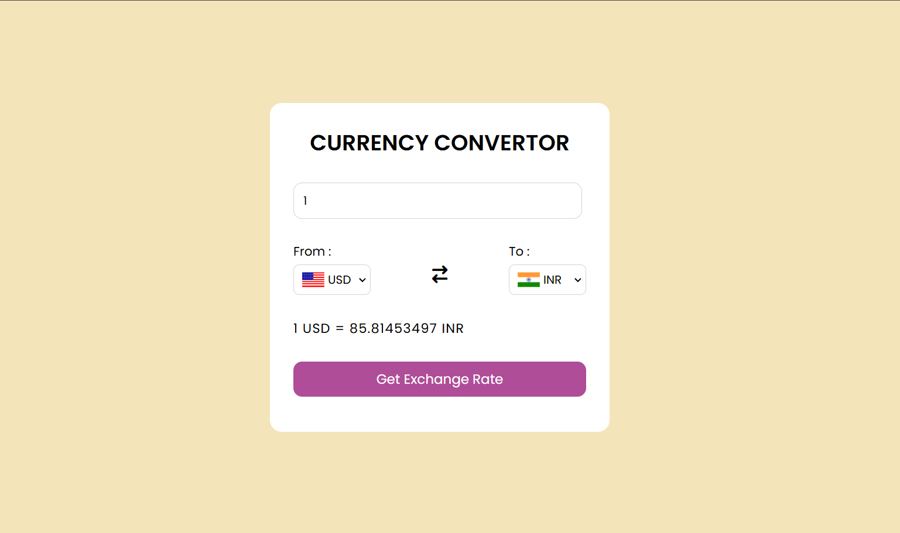

# 🌎💱 Currency Converter  


A **Currency Converter** web application that allows users to **convert values between different currencies in real-time**.

This project is built with **HTML, CSS, and JavaScript**, utilizing a **currency exchange API** to fetch up-to-date conversion rates.  

---

## 📸 Screenshots

### Homepage :


---

## 🌐 Live Demo

You can view the live demo of this project here: [Currency Converter](https://tonystark-19.github.io/Currency-convertor/)  

---

## ✨ Features

| Feature | Description |
|:---|:---|
| **Multi-Currency Conversion** | Supports conversion between 100+ international currencies. |
| **Real-Time Exchange Rates** | Fetches up-to-date currency exchange rates through an external API. |
| **Fully Responsive Design** | Provides a seamless experience across desktops, tablets, and smartphones. |
| **Error Handling** | Handles invalid inputs and network issues gracefully with appropriate feedback. |
| **Fast & Lightweight** | Built using vanilla HTML, CSS, and JavaScript without relying on external frameworks. |
| **GitHub Pages Deployment** | Hosted and deployed using GitHub Pages for easy access and availability. |

---

## 🛠️ Technologies Used

| Technology | Purpose |
|:---|:---|
| **HTML** | Structures the web application's content and layout. |
| **CSS** | Handles styling, layouts, and responsive design. |
| **JavaScript** | Implements dynamic functionality, currency conversion logic, and API integration. |
| **Exchange Rate API** | Fetches real-time currency exchange rates for accurate conversions. |
| **GitHub Pages** | Hosts and deploys the web application. | 

---

## 🛠️ How to Install

1. Clone the repository:

   ```bash
   git clone https://github.com/TonyStark-19/Currency-convertor.git
   ```

2. Navigate into the project folder:

   ```bash
   cd Currency-convertor
   ```

3. Open `index.html` in your browser.

---

## 📝 How to Use

| Step | Instructions |
|:---:|:---|
| **1** | Enter the amount you want to convert. |
| **2** | Select the source currency from the dropdown menu. |
| **3** | Select the target currency from the dropdown menu. |
| **4** | Click the **Get Exchange Rate** button to view the converted amount. |

---

## ⭐ Feedback

If you like this project, consider giving it a ⭐ on GitHub — it motivates me to create more!

---

Made with ❤️ by Aditya chandel